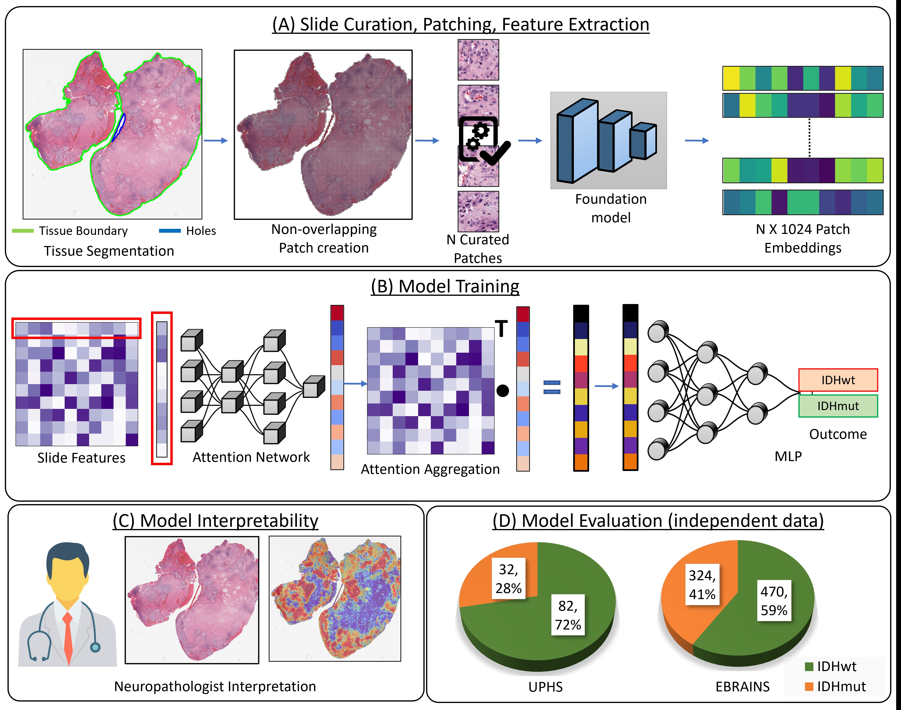

# Interpretable artificial intelligence-based determination of glioma IDH mutation status directly from histology slides



Isocitrate dehydrogenase (IDH) mutation status is a diagnostic requirement for glioma with associated prognostic and therapeutic implications. Clinical routine visual assessment of tissue is insufficient to determine IDH status conclusively, mandating molecular workup that is unavailable everywhere. We developed an interpretable Artificial Intelligence (AI)-based approach for determining IDH status directly from H&E-stained glioma slides.


## Environment

* Linux (tested on Ubuntu 22.04); an NVIDIA GPU is recommended for feature extraction (training on pre-extracted features also runs on CPU)
* Python 3.10+, PyTorch 2.x

```bash
sudo apt-get install openslide-tools        # OpenSlide C library (or: conda install -c conda-forge openslide)
git clone --recurse-submodules https://github.com/IUCompPath/IDHclassifier.git
cd IDHclassifier
conda env create -f environment.yml          # creates `idh_classifier`
conda activate idh_classifier
# install the PyTorch build that matches your CUDA, e.g.
pip install torch torchvision --index-url https://download.pytorch.org/whl/cu121
```

`pip install -r requirements.txt` works as well if you prefer a plain virtualenv.
The old CLAM-era `idh_classifier.yaml` (Python 3.7 / PyTorch 1.3) was removed because it could not run the UNI / timm-based extractors.
The optional `smooth-topk` package is only needed if you pass `--bag_loss svm` or `--inst_loss svm`; the default configuration does not use it.

## Data

The study uses 2442 H&E whole-slide images from three retrospective glioma collections, reclassified according to WHO 2021: TCGA-GBM/LGG (1534 WSIs, 799 patients; method development, 10-fold cross-validation), and two independent hold-out cohorts, UPHS (114 WSIs/patients) and EBRAINS (794 WSIs/patients). Only the TCGA slides are public; this repository ships the TCGA labels (`dataset_csv/df_idh_label.csv`) and splits.

Label coding differs between the label files: `df_idh_label.csv` (TCGA) uses **1 = IDH-mutant, 0 = IDH-wildtype**, whereas `dataset_csv/ebrain_df_label_idh.csv` uses 0 = IDH-mutant, 1 = IDH-wildtype. Re-map one of them before evaluating a TCGA-trained model on EBRAINS.

## Pipeline overview

```
slides -> 1. segmentation + patch coordinates -> 2. patch cleaning -> 3. feature extraction -> 4. train (10-fold) -> 5. evaluate
```

All commands are run from the repository root. Intermediate data goes to `data/` and `features/`, outputs to `results/` and `eval_results/` (all git-ignored).

### 1-2. WSI segmentation, patching and cleaning

Put the slides in `data/slides_20x/` and/or `data/slides_40x/`:

```
data/slides_20x/patient_1_slide_a.svs
data/slides_40x/patient_2_slide_a.svs
```

```bash
./scripts/create_patches.sh 20x     # 256 px patches
./scripts/create_patches.sh 40x     # 512 px patches (same field of view as 256 px at 20x)
```

Outputs per magnification (`data/slides_patches_<mag>/`): `masks/`, `patches/<slide>.h5` (coordinates), `stitches/`, `process_list_autogen.csv`.
The second step (`step_1a_patch_cleaning.py`) rewrites the `.h5` files in place and drops patches that are mostly background (white/black pixels), lack H&E stain (HED colour deconvolution), or are blurry/low-saturation (HSV thresholds, magnification specific). Segmentation parameters come from `presets/tcga.csv`.

### 3. Feature extraction

```bash
./scripts/create_features.sh <MAG> <BACKBONE> [BATCH_SIZE]
./scripts/create_features.sh 20x uni 128
```

This calls `extract_features.py` and writes `features/<MAG>/<BACKBONE>/pt_files/<slide>.pt` (plus `h5_files/` with coordinates). The slide list comes from `dataset_csv/all_slides_gbm_lgg_<MAG>.csv`. Patches are resized to 224 px.

| Backbone | Feature dim | Weights |
| :--- | :--- | :--- |
| `uni` | 1024 | [UNI](https://github.com/mahmoodlab/UNI): request access on HuggingFace and run `huggingface-cli login`; downloaded automatically to `assets/ckpts/uni/` |
| `ctranspath` | 768 | [CTransPath](https://github.com/Xiyue-Wang/TransPath): put `ctranspath.pth` in `create_features_scripts/TransPath/` (git submodule; it needs `timm==0.5.4`, see its README) |
| `retccl` | 2048 | [RetCCL](https://github.com/Xiyue-Wang/RetCCL): put `best_ckpt.pth` in `create_features_scripts/` |
| `hipt4k` | 192 | [HIPT](https://github.com/mahmoodlab/HIPT): put the checkpoints in `create_features_scripts/HIPT_4K/Checkpoints/` |
| `lunit` | 384 | [Lunit DINO ViT-S/8](https://github.com/lunit-io/benchmark-ssl-pathology): downloaded automatically |
| `simclr` | 512 | [SimCLR ResNet-18](https://github.com/ozanciga/self-supervised-histopathology): put `tenpercent_resnet18.ckpt` in `create_features_scripts/` |
| `imagenet` | 1024 | ImageNet ResNet-50 truncated after layer 3: downloaded automatically |

The feature dimension is detected from the extracted features (`--embed_dim` overrides it), so every backbone trains without code changes. Please respect each model's licence and access terms.

### 4. Training

```bash
./scripts/train.sh <MAG> <BACKBONE> [SPLITS]
./scripts/train.sh 20x uni                 # SPLITS defaults to tcga_idh_100
```

The model is a pure attention-based MIL classifier (CLAM-SB architecture without instance-level clustering; see [CLAM](https://github.com/mahmoodlab/CLAM)): 10 folds, Adam, lr 1e-4, weight decay 1e-5, class-balanced sampling, early stopping on validation loss (patience 20, from epoch 50), seed 1. Results go to `results/idh_<MAG>_<BACKBONE>_s1/` (`s_<fold>_checkpoint.pt`, `split_<fold>_results.pkl`, `summary.csv`).

Split sets in `splits/` are patient-level; no patient appears in more than one of train/val/test within a fold (checked):

| Folder | Description |
| :--- | :--- |
| `tcga_idh_100` | all 1534 TCGA GBM/LGG slides, 100% of training labels |
| `tcga_idh_10_folds_excluded_g2_oligodendros` | 982 slides, grade-2 oligodendrogliomas excluded |
| `tcga_idh_10_folds_excluded_g2_oligos_blank_methylated` | 820 slides, grade-2 oligodendrogliomas and blank/methylated cases excluded |

Pass another set as the third argument of `train.sh` (or `--split_dir` to `main.py`).

### 5. Evaluation

```bash
./scripts/eval.sh <MAG> <BACKBONE> [SPLITS]
./scripts/eval.sh 20x uni
```

Per-fold slide predictions and `summary.csv` (AUC, accuracy) go to `eval_results/EVAL_idh_<MAG>_<BACKBONE>/`.

## Reproducibility

* Fixed splits are in `splits/`; labels are in `dataset_csv/df_idh_label.csv` (`label` 1 = IDH-mutant, 0 = IDH-wildtype).
* `main.py` seeds Python, NumPy and PyTorch before every fold and enables deterministic cuDNN. Re-running the same command on the same machine gave bit-identical checkpoints in our CPU test; GPU results may still differ slightly across GPU, driver and PyTorch versions.
* Run settings are saved to `results/<exp>/experiment_<exp>.txt` and the exact fold membership to `results/<exp>/splits_<fold>.csv`.
* Feature extraction depends on the pretrained weights and library versions, so differences there propagate to the final metrics.

### Smoke test (no slides or GPU needed)

`smoke_test/` ships 24 real TCGA slides (12 IDH-mutant / 12 wildtype, one per patient) as UNI 20x features with 24 randomly sampled patches each (about 1-2 MB), patient-disjoint 3-fold splits, and a script that trains and evaluates on them:

```bash
./smoke_test/run_smoke_test.sh
```

It takes about a minute on CPU and writes to `smoke_test/out/` (git-ignored). It only checks that the training and evaluation code runs; the metrics are meaningless on 24 slides. `smoke_test/make_smoke_data.py` documents how the data was sampled.

## Repository layout

```
main.py, eval.py           training / evaluation (CLAM-based MIL)
step_1_patching.py         tissue segmentation + patch coordinates
step_1a_patch_cleaning.py  patch quality filtering
extract_features.py        feature extraction for all backbones
smoke_test/                tiny dataset + script for a train/eval sanity run
models/ datasets/ utils/   MIL models, datasets, helpers
wsi_core/                  whole-slide image utilities (from CLAM)
create_features_scripts/   third-party backbone code (HIPT, RetCCL, TransPath)
dataset_csv/ splits/ presets/ scripts/
```

## References
1. Lu, Ming Y., et al. "Data-efficient and weakly supervised computational pathology on whole-slide images." Nature biomedical engineering 5.6 (2021): 555-570.
2. Wang, Xiyue, et al. "RetCCL: Clustering-guided contrastive learning for whole-slide image retrieval." Medical image analysis 83 (2023): 102645.
3. Kang, Mingu, et al. "Benchmarking self-supervised learning on diverse pathology datasets." Proceedings of the IEEE/CVF Conference on Computer Vision and Pattern Recognition. 2023.
4. Chen, Richard J., et al. "Towards a general-purpose foundation model for computational pathology." Nature medicine 30.3 (2024): 850-862.
5. Wang, Xiyue, et al. "Transformer-based unsupervised contrastive learning for histopathological image classification." Medical image analysis 81 (2022): 102559.
6. Srinidhi, Chetan L., and Anne L. Martel. "Improving self-supervised learning with hardness-aware dynamic curriculum learning: an application to digital pathology." Proceedings of the IEEE/CVF International Conference on Computer Vision. 2021.
7. Chen, Richard J., et al. "Scaling vision transformers to gigapixel images via hierarchical self-supervised learning." Proceedings of the IEEE/CVF conference on computer vision and pattern recognition. 2022.

## Citations

Shubham Innani, W Robert Bell, Hannah Harmsen, MacLean P Nasrallah, Bhakti Baheti, Spyridon Bakas, Interpretable artificial intelligence based determination of glioma IDH mutation status directly from histology slides, Neuro-Oncology Advances, Volume 7, Issue 1, January-December 2025, vdaf140, https://doi.org/10.1093/noajnl/vdaf140

```bash

@article{10.1093/noajnl/vdaf140,
    author = {Innani, Shubham and Bell, W Robert and Harmsen, Hannah and Nasrallah, MacLean P and Baheti, Bhakti and Bakas, Spyridon},
    title = {Interpretable artificial intelligence based determination of glioma IDH mutation status directly from histology slides},
    journal = {Neuro-Oncology Advances},
    volume = {7},
    number = {1},
    pages = {vdaf140},
    year = {2025},
    month = {07},
    issn = {2632-2498},
    doi = {10.1093/noajnl/vdaf140},
    url = {https://doi.org/10.1093/noajnl/vdaf140},
    eprint = {https://academic.oup.com/noa/article-pdf/7/1/vdaf140/63738190/vdaf140.pdf},
}
```

